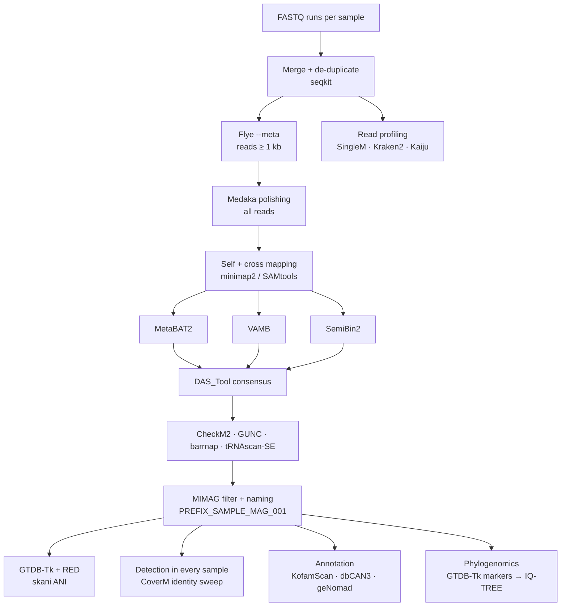

<p align="center">
  
</p>

<p align="center">
  <a href="https://snakemake.github.io"></a>
  
  
  <a href="LICENSE"></a>
</p>

**ont-mag-workflow** is a Snakemake workflow for genome-resolved metagenomics from
**Oxford Nanopore long reads**. It takes raw FASTQ files from one or more samples and
returns a quality-checked, taxonomically classified and annotated catalogue of
metagenome-assembled genomes (MAGs), together with read-level community profiles and
per-genome detection calls in every sample you provide.

It was developed for the sediment and enrichment-culture metagenomes of
**Etoliko Lagoon** (Western Greece), a permanently anoxic, sulfidic coastal basin, and
reproduces the genome-resolved analysis of the paper
*[Long-Read Genome-Resolved Metagenomics of a Permanently Sulfidic Lagoon Sediment: Novel
Anaerobic Lineages, Unbinned Sulfate Reducers and a Methylotrophic Route for Methanogenesis](#citation)*. Nothing in it is specific to Etoliko: point it at
your own reads and databases and it runs the same analysis on your data.

---

## Contents

- [What it does](#what-it-does)
- [Requirements](#requirements)
- [Installation](#installation)
- [Databases](#databases)
- [Input](#input)
- [Running the workflow](#running-the-workflow)
- [Configuration](#configuration)
- [Output](#output)
- [Dependencies](#dependencies)
- [Interpretation notes](#interpretation-notes)
- [Not automated](#not-automated)
- [Citation](#citation)

---

## What it does



| Stage | Tools | Main result |
|---|---|---|
| Read preparation | seqkit | merged, de-duplicated reads; read statistics |
| Assembly | Flye (`--meta --nano-hq`), Medaka | polished contigs per sample |
| Coverage | minimap2, SAMtools | every read set mapped to every assembly (differential coverage) |
| Binning | MetaBAT2, VAMB, SemiBin2, DAS_Tool | one non-redundant bin set per sample |
| Genome quality | CheckM2, GUNC, barrnap, tRNAscan-SE | completeness, contamination, chimerism, rRNA/tRNA → MIMAG tier |
| Taxonomy | GTDB-Tk (+ RED), skani | GTDB classification, ANI among MAGs and to your reference genomes |
| Detection | CoverM, pysam | abundance, breadth at 90–99 % identity, read-identity mode, detection call |
| Read profiling | SingleM, Kraken2/Bracken, Kaiju | community composition from reads, including unbinned taxa |
| Annotation | Prodigal, KofamScan, dbCAN3, geNomad | KEGG orthologs, CAZymes, viruses/plasmids |
| Phylogenomics | GTDB-Tk, IQ-TREE | bac120 / ar53 trees with your reference genomes |
| Optional | antiSMASH, Bakta, gapseq + SMETANA, DIAMOND | BGCs, full annotation, metabolic models, gene-panel read counts |

---

## Requirements

| Resource | Recommended | Notes |
|---|---|---|
| OS | Linux (x86-64) | macOS works for small tests; several tools have no ARM builds |
| CPU | 32 cores | set in `config/config.yaml → threads` |
| RAM | 250 GB | Flye metagenome assembly of ~10 Gbp; GTDB-Tk needs ~120 GB |
| Disk | ~400 GB | ~250 GB databases + intermediate files |
| Software | conda or mamba, Snakemake ≥ 8 | every tool is installed automatically |

Smaller datasets need much less: a 2–3 Gbp metagenome assembles in well under 100 GB RAM.

---

## Installation

**1. Install conda/mamba** (skip if you have it) — [Miniforge](https://github.com/conda-forge/miniforge) is recommended:

```bash
curl -L -O https://github.com/conda-forge/miniforge/releases/latest/download/Miniforge3-Linux-x86_64.sh
bash Miniforge3-Linux-x86_64.sh
```

**2. Create an environment with Snakemake:**

```bash
mamba create -n snakemake -c conda-forge -c bioconda "snakemake>=8" pandas
mamba activate snakemake
```

**3. Get the workflow:**

```bash
git clone https://github.com/YiannisGal/ont-mag-workflow.git
cd ont-mag-workflow
```

**4. Install the tool environments** (optional — otherwise this happens on the first run):

```bash
snakemake --workflow-profile profiles/default --conda-create-envs-only --cores 4
```

Each step runs in its own conda environment defined in [`workflow/envs/`](workflow/envs),
so tools with conflicting dependencies never share an environment.

---

## Databases

Download once and put the paths in `config/config.yaml → databases`.
A helper script with all commands is provided:

```bash
bash workflow/scripts/download_databases.sh /path/to/databases
```

| Database | Used by | Version used | Approx. size | Needed for | Config key |
|---|---|---|---|---|---|
| CheckM2 (UniRef100 KO) | CheckM2 | 1.1.0 DB | 3 GB | **required** | `checkm2` |
| proGenomes 2.1 | GUNC | 2.1 | 13 GB | **required** | `gunc` |
| GTDB | GTDB-Tk | release 232 | ~140 GB | **required** | `gtdbtk` |
| KOfam profiles + ko_list | KofamScan | current | 4 GB | annotation | `kofam_profiles`, `kofam_ko_list` |
| dbCAN | run_dbcan | dbCAN3 HMMdb | 2 GB | annotation | `dbcan` |
| geNomad DB | geNomad | current | 1.5 GB | annotation | `genomad` |
| SingleM metapackage | SingleM | default (GTDB-based) | 5 GB | read profiling | `singlem_metapackage` |
| Kraken2 index | Kraken2/Bracken | any prebuilt | 8–100 GB | optional | `kraken2` |
| Kaiju proGenomes | Kaiju | proGenomes | ~40 GB | optional | `kaiju_nodes`, `kaiju_names`, `kaiju_fmi` |
| Bakta full | Bakta | v5.1 | ~70 GB | optional | `bakta` |
| antiSMASH (incl. MIBiG) | antiSMASH | 8.x | ~10 GB | optional | `antismash` |

Sizes are approximate and grow with new releases. Any optional database left empty
(`""`) in the config switches that step off.

> **Version matters for GTDB-Tk:** GTDB-Tk 2.7.x expects GTDB release 232. If you use a
> different release, change the GTDB-Tk version in `workflow/envs/gtdbtk.yaml` to match.

---

## Input

Two tab-separated sample sheets in `config/`:

**`config/samples.tsv`** — one row per sample

```tsv
sample	role	description
SED	assemble	lagoon sediment
LIQ	assemble	enrichment cultures
PUB1	detect_only	public metagenome (detection only)
```

| Column | Meaning |
|---|---|
| `sample` | short name, letters and digits only — used in contig and MAG names |
| `role` | `assemble`: assembled, binned and used as a coverage source; `detect_only`: only searched for the MAGs |

**`config/units.tsv`** — one row per sequencing run (FASTQ file)

```tsv
sample	unit	fastq	profile
SED	run01	/data/SED_run01.fastq.gz	yes
SED	amplicon	/data/SED_amplicon.fastq.gz	no
LIQ	run01	/data/LIQ_run01.fastq.gz	yes
```

| Column | Meaning |
|---|---|
| `fastq` | path to `.fastq` or `.fastq.gz` (basecalled, demultiplexed) |
| `profile` | `yes`: include in read-level profiling; `no`: use only for assembly and mapping (e.g. amplicon or PCR runs) |

All runs of a sample are concatenated and de-duplicated by read ID. Reads ≥ 1 kb are
assembled; **all** reads are used for polishing, mapping and detection.

---

## Running the workflow

```bash
# 1. dry run: check inputs and see the planned jobs
snakemake --workflow-profile profiles/default -n

# 2. run
snakemake --workflow-profile profiles/default --cores 32

# on a SLURM cluster (needs snakemake-executor-plugin-slurm)
snakemake --workflow-profile profiles/default --executor slurm --jobs 20
```

The workflow can be stopped and restarted at any time: it resumes from the last
completed step. Use `screen` or `tmux` for long runs.

---

## Configuration

All settings live in [`config/config.yaml`](config/config.yaml). The ones you are most
likely to change:

| Setting | Default | Notes |
|---|---|---|
| `project_prefix` | `ETO` | MAG IDs become `ETO_SED_MAG_001`, numbered best first |
| `assembly.medaka_model` | `r1041_e82_400bps_sup_v5.0.0` | **must match your flow cell and basecalling model** |
| `assembly.flye_read_type` | `--nano-hq` | for R10.4.1 + Dorado sup; `--nano-raw` for older chemistry |
| `binning.min_contig_len` | 2000 | minimum contig length for binning |
| `binning.min_bin_size` | 200000 | minimum bin size (bp) |
| `mag_filter` | ≥ 50 % complete, ≤ 10 % contaminated, GUNC pass | MIMAG medium quality and above |
| `detection.identities` | 90, 95, 97, 99 | read-identity thresholds for the breadth sweep |
| `reference_genomes` | `""` | folder of isolate / reference genomes for ANI and the tree |
| `modules.*` | — | switch optional parts on or off |

---

## Output

All results go to `results/`:

| Path | Content |
|---|---|
| `qc/read_stats.tsv`, `qc/assembly_stats.tsv` | read and assembly statistics |
| `mapping/<assembly>/flagstat/` | percentage of each read set mapping to each assembly |
| `mags/mag_summary.tsv` | every bin: CheckM2, GUNC, rRNA, tRNA types, MIMAG tier, selected or not |
| `mags/MAG_CROSSWALK.tsv` | final MAG ID ↔ original bin ↔ winning binner |
| `mags/fasta/` | **the MAG catalogue** |
| `taxonomy/gtdbtk_summary.tsv` | GTDB classification of bacteria and archaea, with RED |
| `taxonomy/skani_*.tsv` | ANI among MAGs and against your reference genomes |
| `detection/coverm_all.tsv` | per MAG × sample: abundance, depth, breadth per identity, identity mode, detection call |
| `read_profiling/` | SingleM profiles and phylum abundance; Kraken2/Bracken; Kaiju |
| `annotation/summary/` | KO and CAZy-family matrices (MAG × feature) |
| `annotation/{kofam,dbcan,genomad,antismash,bakta}/` | full per-MAG results |
| `phylogeny/trees/` | IQ-TREE trees (`bac120`, `ar53`) |
| `gene_panel/` | competitive read counts per gene (optional module) |
| `logs/` | one log per job |

---

## Dependencies

Installed automatically by Snakemake from bioconda/conda-forge.
"Version used" is what produced the Etoliko results.

| Tool | Version used | Purpose | Reference |
|---|---|---|---|
| [Snakemake](https://snakemake.github.io) | ≥ 8 | workflow manager | Mölder et al. 2021 |
| [seqkit](https://github.com/shenwei356/seqkit) | 2.3.0 | read handling, statistics | Shen et al. 2016 |
| [Flye](https://github.com/mikolmogorov/Flye) | 2.9.3 | metagenome assembly | Kolmogorov et al. 2020 |
| [Medaka](https://github.com/nanoporetech/medaka) | 2.1.1 | polishing | Oxford Nanopore |
| [minimap2](https://github.com/lh3/minimap2) | 2.28 | read mapping | Li 2018 |
| [SAMtools](https://github.com/samtools/samtools) | 1.19.2 | BAM processing | Danecek et al. 2021 |
| [MetaBAT2](https://bitbucket.org/berkeleylab/metabat) | 2.18 | binning | Kang et al. 2019 |
| [VAMB](https://github.com/RasmussenLab/vamb) | 5.0.4 | binning | Nissen et al. 2021 |
| [SemiBin2](https://github.com/BigDataBiology/SemiBin) | 2.2.1 | binning | Pan et al. 2023 |
| [DAS_Tool](https://github.com/cmks/DAS_Tool) | 1.1.7 | bin consensus | Sieber et al. 2018 |
| [CheckM2](https://github.com/chklovski/CheckM2) | 1.1.0 | completeness / contamination | Chklovski et al. 2023 |
| [GUNC](https://github.com/grp-bork/gunc) | 1.0.3 | chimerism | Orakov et al. 2021 |
| [barrnap](https://github.com/tseemann/barrnap) | 0.9 | rRNA genes | Seemann |
| [tRNAscan-SE](https://github.com/UCSC-LoweLab/tRNAscan-SE) | 2.0.13 | tRNA genes | Chan et al. 2021 |
| [GTDB-Tk](https://github.com/Ecogenomics/GTDBTk) | 2.7.2 | taxonomy (GTDB R232) | Chaumeil et al. 2022 |
| [skani](https://github.com/bluenote-1577/skani) | — | ANI | Shaw & Yu 2023 |
| [CoverM](https://github.com/wwood/CoverM) | 0.7.0 | coverage, breadth | Aroney et al. 2025 |
| [IQ-TREE](https://github.com/iqtree/iqtree3) | 3.1.1 | phylogenomics | Minh et al. 2020 |
| [SingleM](https://github.com/wwood/singlem) | — | read-based community profile | Woodcroft et al. 2025 |
| [Kraken2](https://github.com/DerrickWood/kraken2) / [Bracken](https://github.com/jenniferlu717/Bracken) | 2.1.3 / 3.0.1 | read taxonomy | Wood et al. 2019; Lu et al. 2017 |
| [Kaiju](https://github.com/bioinformatics-centre/kaiju) | 1.10.1 | protein-level read taxonomy | Menzel et al. 2016 |
| [Prodigal](https://github.com/hyattpd/Prodigal) | 2.6.3 | gene prediction | Hyatt et al. 2010 |
| [KofamScan](https://github.com/takaram/kofam_scan) | 1.3.0 | KEGG orthologs | Aramaki et al. 2020 |
| [dbCAN](https://github.com/bcb-unl/run_dbcan) | 4.1.4 (dbCAN3) | CAZymes | Zheng et al. 2023 |
| [geNomad](https://github.com/apcamargo/genomad) | — | viruses, plasmids | Camargo et al. 2024 |
| [antiSMASH](https://github.com/antismash/antismash) | 8.0.4 | biosynthetic gene clusters (optional) | Blin et al. 2023 |
| [Bakta](https://github.com/oschwengers/bakta) | 1.9.4 | full annotation (optional) | Schwengers et al. 2021 |
| [gapseq](https://github.com/jotech/gapseq) / [SMETANA](https://github.com/cdanielmachado/smetana) | — | metabolic models (optional) | Zimmermann et al. 2021; Zelezniak et al. 2015 |
| [DIAMOND](https://github.com/bbuchfink/diamond) | 2.1.9 | gene-panel read search (optional) | Buchfink et al. 2021 |
| Python: pandas, pysam | — | summary scripts | — |

Where bioconda lacks the exact build used, the environment file says so in a comment.

---

## Interpretation notes

Lessons from the Etoliko analysis that apply to any long-read metagenome:

- **Detection is not abundance.** A genome is called a *same-species population* only when
  its read-identity distribution peaks at ≥ 97 % **and** breadth at ≥ 90 % identity is ≥ 0.5;
  a *related population* when breadth at ≥ 90 % identity is ≥ 0.1 at lower identity.
  Check where reads from a genome known to be present peak in your library (98–99 % for
  R10.4.1 sup) and adjust `detection.*` if needed.
- **PCR-amplified libraries distort abundance.** Use them for assembly and detection, not
  for quantitative claims.
- **Use KofamScan's curated thresholds.** A flat E-value cut-off inflated hits ~5-fold
  overall and ~29-fold for transporters.
- **Competitive read searches need decoys.** In the gene panel, include all sibling families
  (e.g. MttB-superfamily methyltransferases next to *mtmB/mtbB/mttB/mtaB*); otherwise most
  hits are mis-assigned.
- **skani only reports pairs above its pre-screen** (~80 % ANI). A missing pair means
  "below the lowest value reported", not zero.
- **Gene absence** is only meaningful for genomes ≥ 90 % complete.

---

## Not automated

These steps of the original study are case-specific; the workflow produces their inputs:

- linking MAG 16S rRNA genes to amplicon OTUs (VSEARCH)
- species/genus delineation of novel taxa (AAI with EzAAI, POCP, dDDH via the TYGS server)
- hydrogenase classification against HydDB
- single-gene trees (e.g. McrA with MAFFT / trimAl / IQ-TREE)
- choice of growth medium for SMETANA

---

## Citation

If you use this workflow, please cite:

> Galiatsatos, I. *et al.* Long-Read Genome-Resolved Metagenomics of a Permanently Sulfidic
> Lagoon Sediment: Novel Anaerobic Lineages, Unbinned Sulfate Reducers and a Methylotrophic
> Route for Methanogenesis. *Microorganisms* (in preparation).

and the tools listed under [Dependencies](#dependencies).

## License

[MIT](LICENSE) © 2026 Ioannis Galiatsatos
